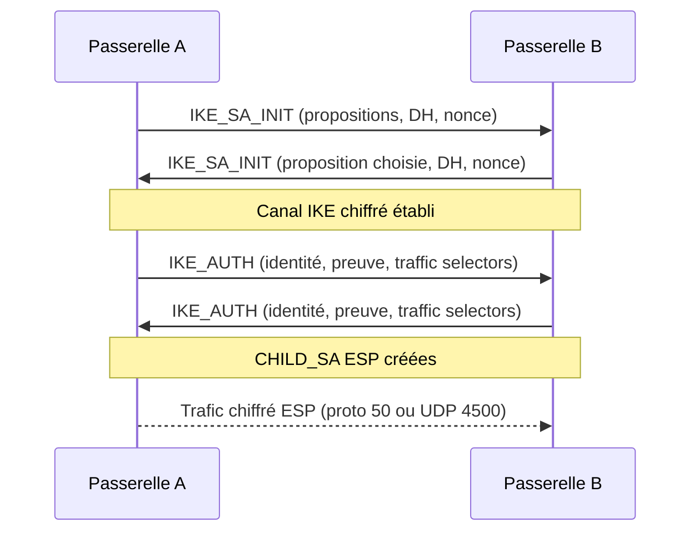

## En bref

IPsec protège le trafic **au niveau IP** : tout ce qui passe dedans (HTTP, SMB, RDP, peu importe) est chiffré et authentifié, sans que les applications le sachent. C'est comme une enveloppe scellée qu'on glisse autour de chaque paquet avant de l'envoyer sur Internet : seul le destinataire qui a la bonne clé peut l'ouvrir et vérifier que personne ne l'a modifiée.

Usage principal : relier deux sites (ou un poste et un site) par un [[VPN]] à travers un réseau non fiable.

## Pourquoi ça existe

IP a été conçu sans sécurité : un paquet peut être lu, modifié ou forgé par n'importe quel équipement sur le chemin. IPsec ajoute trois garanties :

- **Confidentialité** : le contenu est chiffré.
- **Intégrité + authenticité** : on sait que le paquet vient bien du pair attendu et n'a pas été altéré.
- **Anti-rejeu** : un paquet capturé puis renvoyé est rejeté (numéro de séquence).

## Comment ça marche

### Les deux protocoles de protection

| Protocole | N° IP | Chiffre ? | Authentifie | Compatible NAT |
|---|---|---|---|---|
| **AH** (Authentication Header) | 51 | Non | Charge utile **et** en-tête IP | Non (le NAT modifie l'en-tête, donc la vérification échoue) |
| **ESP** (Encapsulating Security Payload) | 50 | Oui | Charge utile (pas l'en-tête IP externe) | Oui, via NAT-T (encapsulation UDP 4500) |

En pratique, on utilise **ESP** presque partout. AH est quasiment abandonné.

### Les deux modes

- **Mode transport** : seule la charge utile est protégée, l'en-tête IP d'origine reste. Utilisé entre deux hôtes (ex. sécuriser le trafic entre deux serveurs).
- **Mode tunnel** : le paquet IP **entier** est chiffré et placé dans un nouveau paquet IP entre les deux passerelles. C'est le mode des VPN site à site : les adresses internes ne sont jamais visibles sur Internet.

### Les SA (Security Associations)

Une SA est un « contrat » entre deux pairs : algorithmes, clés, durée de vie. Points importants :

- Une SA est **unidirectionnelle** : un tunnel fonctionnel = au moins 2 SA ESP (une par sens).
- Chaque SA est identifiée par un **SPI** (Security Parameter Index) présent dans chaque paquet ESP.
- La **SPD** (Security Policy Database) dit *quel trafic* doit être protégé (les « traffic selectors », ex. 10.1.0.0/24 ↔ 10.2.0.0/24). La **SAD** contient les SA actives.

### IKE : la négociation des clés

Configurer les clés à la main serait ingérable. **IKE** (Internet Key Exchange, UDP 500, ou UDP 4500 derrière un NAT) négocie tout automatiquement. On utilise aujourd'hui [[IKEv2]] :

1. **IKE_SA_INIT** : les pairs s'accordent sur les algorithmes et font un échange [[Diffie-Hellman]] pour obtenir un secret commun sans jamais l'envoyer sur le réseau.
2. **IKE_AUTH** : chaque pair prouve son identité (clé pré-partagée/PSK ou certificats [[PKI]]) et la première paire de SA ESP (« CHILD_SA ») est créée.
3. **CREATE_CHILD_SA** : renouvellement des clés (rekey) ou création de SA supplémentaires.



Avec IKEv1 (ancien), on parle de **phase 1** (main mode ou aggressive mode) et **phase 2** (quick mode). Le vocabulaire « phase 1 / phase 2 » est encore très courant dans les interfaces des pare-feu.

## En pratique

### Flux réseau à autoriser entre les deux passerelles

```text
UDP 500    IKE
UDP 4500   IKE + ESP encapsulé (NAT-T)
IP proto 50  ESP (si pas de NAT)
```

### Linux avec strongSwan (swanctl)

`/etc/swanctl/conf.d/site-a-b.conf` (adresses de documentation, à adapter) :

```conf
connections {
  site-a-b {
    version = 2
    local_addrs  = 203.0.113.1
    remote_addrs = 198.51.100.1
    proposals = aes256gcm16-prfsha384-ecp384      # phase 1 : chiffrement, PRF, groupe DH
    local  { auth = psk  id = site-a }
    remote { auth = psk  id = site-b }
    children {
      net-net {
        local_ts  = 10.1.0.0/24                    # réseau local protégé
        remote_ts = 10.2.0.0/24                    # réseau distant
        esp_proposals = aes256gcm16-ecp384         # phase 2 (avec PFS)
        start_action = start
      }
    }
  }
}
secrets {
  ike-b { id = site-b  secret = "à-remplacer-par-un-secret-long" }
}
```

```bash
swanctl --load-all                 # charge config et secrets
swanctl --initiate --child net-net # monte le tunnel
swanctl --list-sas                 # état des SA IKE et ESP
ip xfrm state                      # SA vues par le noyau
ip xfrm policy                     # politiques (SPD)
tcpdump -ni eth0 'udp port 500 or udp port 4500 or esp'   # voir la négociation
journalctl -u strongswan -f        # logs en direct
```

### Windows

```powershell
Get-NetIPsecMainModeSA        # SA de phase 1 actives
Get-NetIPsecQuickModeSA       # SA de phase 2 actives
Get-NetIPsecRule              # règles de sécurité de connexion
netsh advfirewall monitor show mmsa   # équivalent netsh
```

## Pièges courants

| Symptôme / erreur | Cause probable | Vérification |
|---|---|---|
| `NO_PROPOSAL_CHOSEN` | Algorithmes ou groupe DH différents entre les pairs | Comparer les propositions phase 1 et phase 2 des deux côtés |
| `AUTHENTICATION_FAILED` | PSK différente ou identités (`id`) qui ne correspondent pas | Vérifier secret et IDs ; les logs indiquent l'ID reçu |
| `TS_UNACCEPTABLE` | Traffic selectors (sous-réseaux) non symétriques | `local_ts` d'un côté = `remote_ts` de l'autre, exactement |
| Phase 1 OK, aucun trafic ne passe | ESP/UDP 4500 filtré, ou routage/NAT qui s'applique avant IPsec | `tcpdump` des deux côtés, règles d'exemption NAT |
| Tunnel qui tombe à intervalles réguliers | Durées de vie ou PFS incohérentes au moment du rekey | Aligner lifetimes et groupe DH de phase 2 |
| Petits paquets OK, gros transferts bloqués | Problème de MTU (l'encapsulation ajoute des octets) | Baisser le MSS TCP (MSS clamping), tester avec `ping -M do -s 1400` |

## Notions liées

- [[VPN]] : IPsec est l'un des protocoles qui permettent de construire un VPN.
- [[IKEv2]] : le protocole qui négocie les clés et les SA.
- [[Diffie-Hellman]] : l'échange qui crée le secret partagé sans le transmettre.
- [[PKI]] : nécessaire pour l'authentification par certificats.

## Quiz

> [!question]- 1. Pourquoi AH ne fonctionne-t-il pas à travers un NAT ?
> AH authentifie aussi l'en-tête IP. Le NAT modifie l'adresse source de cet en-tête, donc la vérification d'intégrité échoue côté destinataire. ESP n'authentifie pas l'en-tête IP externe et peut être encapsulé dans UDP 4500 (NAT-T).

> [!question]- 2. Combien de SA ESP faut-il au minimum pour un tunnel qui fonctionne dans les deux sens ?
> Deux : une SA est unidirectionnelle, il en faut une par sens. Elles sont créées par paire lors de IKE_AUTH ou CREATE_CHILD_SA.

> [!question]- 3. Quelle est la différence entre mode transport et mode tunnel ?
> En transport, seule la charge utile est protégée et l'en-tête IP d'origine reste visible (hôte à hôte). En tunnel, tout le paquet d'origine est chiffré et encapsulé dans un nouveau paquet IP entre les passerelles (VPN site à site).

> [!question]- 4. Les logs affichent `TS_UNACCEPTABLE`. Que vérifies-tu ?
> Les traffic selectors : les sous-réseaux protégés doivent être le miroir exact l'un de l'autre (local d'un côté = remote de l'autre).

> [!question]- 5. Quels flux faut-il ouvrir entre deux passerelles IPsec dont une est derrière un NAT ?
> UDP 500 pour démarrer IKE, puis UDP 4500 qui transporte IKE et l'ESP encapsulé (NAT-T). Le protocole IP 50 n'est utile que sans NAT.

## Pour aller plus loin

- RFC 4301 : architecture IPsec
- RFC 4303 : ESP — RFC 4302 : AH
- RFC 7296 : IKEv2
- RFC 3948 : encapsulation UDP de l'ESP (NAT-T)
- Documentation strongSwan : configuration `swanctl.conf`
